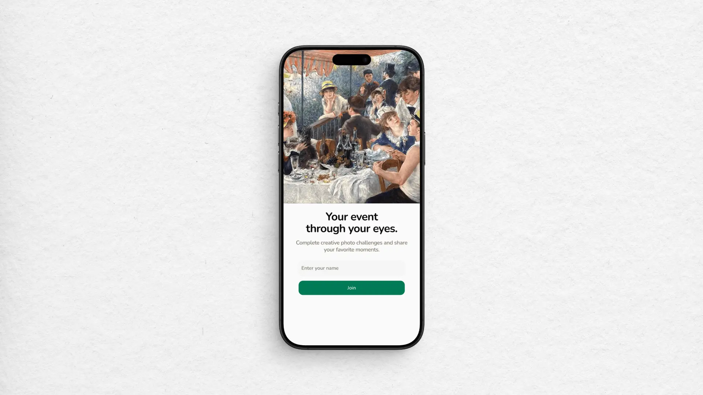
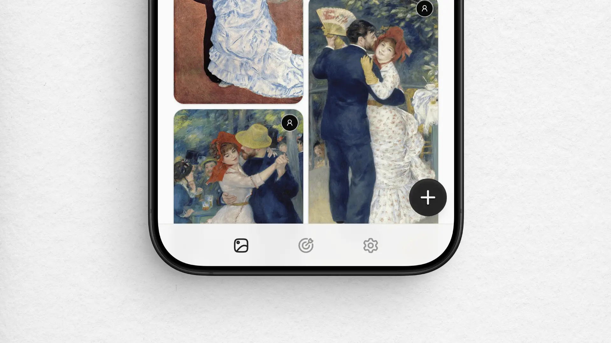
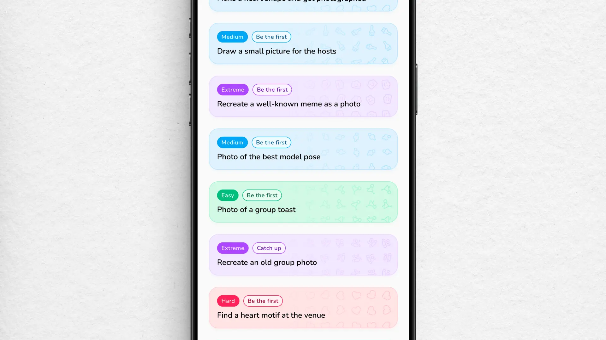

import BlogVideo from "@/components/blog-video.astro";

# Eine Foto-App für eine Hochzeit

Freunde von mir haben vor Kurzem geheiratet. Für ihre Hochzeit habe ich eine kleine Web-App gebaut, in der die Gäste Fotos in eine gemeinsame Galerie hochladen und zusammen Foto-Challenges erfüllen konnten.

Solche Apps gibt es schon, aber ich wollte mehr Kontrolle über das Look and Feel haben. OpenAI Codex hat mir einen großen Teil der Programmierarbeit abgenommen und die Entwicklung schneller und einfacher gemacht. Am Ende habe ich ziemlich viel Zeit in die Details gesteckt, vor allem in die Challenges, die Lightbox und die Ladezeiten der Bilder. Hier möchte ich mich auf die Gestaltung und die Entscheidungen zur Bedienung konzentrieren und nur kurz auf die Technik dahinter eingehen. Der Code ist [Open Source und auf GitHub verfügbar](https://github.com/michaelheckmann/event-photo-challenges).

## Ein einfacher Einstieg

Die meisten Gäste würden die App vermutlich nur für dieses eine Event nutzen. Viel Zeit, sich an eine neue Oberfläche zu gewöhnen, würde also nicht bleiben. Deshalb sollte der Einstieg möglichst unkompliziert sein.

Die Gäste mussten nur einen QR-Code scannen, um die App im Browser zu öffnen, ohne etwas installieren zu müssen. Als Web-App kam sie ohne Installation aus und funktionierte von Haus aus auf jedem Gerät.

Beim Onboarding habe ich nur nach einem Namen gefragt, damit die anderen sehen konnten, von wem ein Foto stammt. Das Feld habe ich bewusst offengelassen: Ein Vorname, ein Spitzname oder sogar ein Emoji reichten aus. Zwei Personen konnten auch denselben Vornamen verwenden. Vollständige Namen zu verlangen oder die Eingaben streng zu validieren, fand ich für so eine App übertrieben.

Nachdem du deinen Namen eingegeben hast, landest du auf dem Hauptbildschirm. Über die Navigationsleiste am unteren Rand wechselst du zwischen Galerie, Challenges und Einstellungen. Ein großer Floating Action Button öffnet den Upload. Ich habe hier bewusst vertraute Muster aus mobilen Apps verwendet. Das folgt [Jakob’s Law](https://www.nngroup.com/videos/jakobs-law-internet-ux/): Menschen bringen Erwartungen aus den Produkten mit, die sie bereits nutzen. Die Gäste würden viel mehr Zeit in anderen Apps verbringen als in dieser. Es lag also nahe, auf dem aufzubauen, was sie schon kannten.

## Challenges, die Spaß machen

Die Challenges sind mein Lieblingsteil. Ich wollte den Gästen ein paar Ideen für Fotomotive geben, auf die sie sonst vielleicht nie gekommen wären. Bei manchen Aufgaben geht es darum, ein Detail zu entdecken. Bei anderen sollst du jemanden mit demselben Sternzeichen finden oder eine Gruppe für ein Foto zusammenbringen.

Die Schwierigkeitsgrade habe ich farblich voneinander abgesetzt. Wenn du nur ein oder zwei leichte Challenges machen möchtest, kannst du sie so schnell in der Liste finden. Labels wie „Be the first“ oder „Catch up“ sollen ein wenig zum Mitmachen anregen. Bei manchen Challenges ist außerdem die Zahl der Teilnehmenden begrenzt. Den Gastgeber zu fotografieren (oder den eigentlichen Fotografen!) kann lustig sein. Wenn das aber alle machen, wird es vermutlich schnell nervig.

Eine Challenge abzuschließen soll sich gut anfühlen. Dafür habe ich den Emoji-Regen aus anderen Apps aufgegriffen und mit haptischem Feedback kombiniert. Der Effekt ist vertraut und passt hier aus meiner Sicht gut: Du lädst dein Foto hoch, die Karte wechselt ihren Zustand und es gibt eine kleine Feier.

Jede Challenge hat ihre eigenen Emojis. Für ein Foto vom jüngsten Gast gibt es 👶 🍼 💛 📸, für ein Foto von der Hochzeitstorte 🍰 💍 ✨ 📸. Es ist nur ein kleines Detail, aber ich mag es, dass die Belohnung zum gerade aufgenommenen Foto passt. Das fühlt sich etwas persönlicher an als ein gewöhnlicher Konfettiregen.

Sobald du eine Challenge abgeschlossen hast, wird ihre Karte grau und zeigt dein eingereichtes Foto. Wenn du darauf tippst, öffnet sich das Bild in der Lightbox. Dort kannst du es herunterladen oder löschen. So siehst du direkt, welche Challenges du schon erledigt hast, und kannst dir das Ergebnis noch einmal ansehen.

Hast du eine Challenge noch nicht abgeschlossen und alle Plätze sind belegt, wird die Karte ebenfalls grau, zeigt aber kein Foto. Stattdessen steht dort „All spots taken“. Die Challenge bleibt in der Liste, denn es kann wieder ein Platz frei werden: Wenn jemand sein Challenge-Foto löscht, wird der Platz frei. Auch die Person, die das Foto gelöscht hat, kann die Challenge dann noch einmal machen.

<BlogVideo
  src="https://player.mediadelivery.net/play/800263/de8a8313-8606-4b6b-ae79-84e30cc91fb2"
  title="Eine Foto-Challenge abschließen"
  lang="de"
/>

Ich war mir nicht sicher, ob die Gäste auf so etwas Lust hätten. Am Ende haben sie viele Fotos gemacht und sich ziemlich auf die Challenges konzentriert. Besonders lustig war die Aufgabe, den Bräutigam zu tragen. Dabei sind tolle Fotos entstanden. Ich glaube, an diesen Moment werden sich die Leute erinnern. Ohne die App hätte es ihn wahrscheinlich nicht gegeben.

## Eine Oberfläche, die sich greifbar anfühlt

Buttons und Karten werden beim Antippen ein kleines Stück kleiner. Verschiedene Interaktionen haben unterschiedliche haptische Signale, etwa der Wechsel zwischen Tabs, die Auswahl von Fotos oder der Abschluss eines Uploads. Mit der [WebHaptics](https://github.com/lochie/web-haptics)-Library ließ sich das einfach umsetzen.

Auch die Überschrift verwandelt sich beim Wechsel zwischen den Bereichen mithilfe von [Torph](https://torph.lochie.me/). Ich wollte hier etwas Bewegung einbauen, ohne die Oberfläche zu unruhig zu machen. Der Morph-Effekt macht den Wechsel sichtbar, ohne dass sich dafür viel bewegen muss.

<BlogVideo
  src="https://player.mediadelivery.net/play/800263/94a4d736-8aa2-43f0-832c-b5383955db2b"
  title="Tab-Wechsel und Touch-Interaktionen"
  lang="de"
/>

## Fotos im Vollbild durchsehen

Den Fotoviewer habe ich rund um Touch-Gesten und vertraute Bedienmuster aus mobilen Apps gestaltet. Wenn du ein Bild öffnest, füllt es den Bildschirm aus. Mit vertikalen Wischgesten gehst du durch die Sammlung. Beim Scrollen rastet das nächste Foto ein. Das ähnelt eher dem vertikalen Durchscrollen bei Instagram als einer klassischen Lightbox.

Viele Lightboxes haben unten eine Leiste mit kleinen Vorschaubildern und Buttons, um nach links oder rechts zu wechseln. In dieser App sollte das Wischen selbst die wichtigste Interaktion sein. Du öffnest ein Foto und gehst mit einer vertrauten Geste durch die weiteren Bilder. Jedes Foto bekommt dabei den ganzen Bildschirm.

<BlogVideo
  src="https://player.mediadelivery.net/play/800263/196e8f4d-273a-4f60-8d77-3ea0879edf3e"
  title="Fotos im Vollbild durchsehen"
  lang="de"
/>

Ein paar kleinere Details helfen dabei: Die Galerie im Hintergrund lässt sich nicht mehr scrollen, solange die Vollbildansicht geöffnet ist. Außerdem ändert sich die Theme-Farbe des Browsers, sodass sich auch dessen Oberfläche an die Fotoansicht anpasst.

## Fotos laden und herunterladen

Die Galerie flüssig zum Laufen zu bringen, war aufwendiger als erwartet. Die Bilder luden langsam und das Masonry-Grid hatte Rendering-Probleme, durch die das Layout immer wieder verrutschte. Ich habe einige Zeit damit verbracht, die Virtualisierung anzupassen und sicherzustellen, dass die Bildabmessungen schon vor dem Positionieren im Grid bekannt waren. Schließlich sollten die Fotos beim Durchsehen nicht ständig neu angeordnet werden.

Die Originale liegen in Cloudflare R2. Mit Cloudflare Image Transformations habe ich kleinere Versionen für die Anzeige erzeugt. Durch responsive Bildgrößen kann die Galerie kleine Thumbnails laden, während die Vollbildansicht ein größeres Bild bekommt. Zusammen mit Caching verhindert das, dass für jede kleine Vorschau das Original heruntergeladen werden muss. Ich hatte Cloudflares Bildtransformationen vorher noch nicht genutzt. Das passende Setup herauszufinden, war also auch Teil der Arbeit.

Für den Download aller Fotos habe ich eine GitHub Action eingerichtet, die ein ZIP-Archiv erstellt und in R2 ablegt. Die Gäste laden diese vorbereitete Datei herunter. So müssen sie nicht erst warten, bis die App die Fotos zusammensucht und verpackt. Der Download enthält die Sammlung vom letzten Archiv-Build.

Außerdem habe ich Versionen der Challenge-Fotos erstellt, bei denen die Aufgabenstellung direkt ins Bild eingebettet ist. Der Text steht unten in Weiß auf einem dunklen Verlauf, damit er sich gut vom Foto abhebt. So bleibt die Aufgabe beim Bild, auch wenn jemand es außerhalb der App speichert oder teilt. Im ZIP liegen sowohl die Originale als auch die Versionen mit Text. Die Gäste können also selbst entscheiden, welche sie behalten möchten.

Ich bin zufrieden mit dem Ergebnis, besonders mit den Challenge-Karten und dem Durchsehen der Fotos im Vollbild. Dass die Gäste die App so viel genutzt haben, hat mich zusätzlich gefreut. Wenn du dir die Umsetzung ansehen möchtest, findest du sie [auf GitHub](https://github.com/michaelheckmann/event-photo-challenges).
