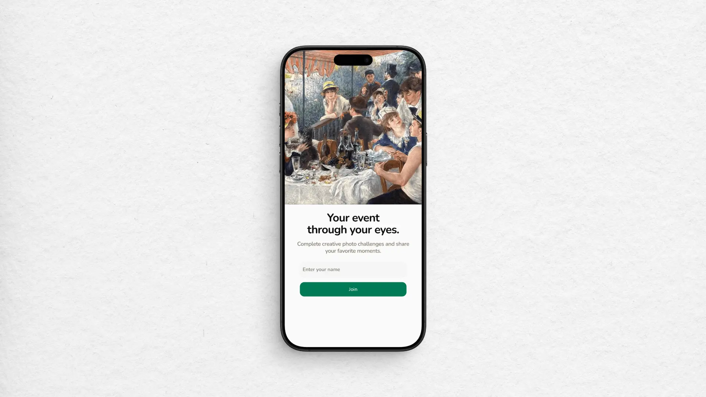
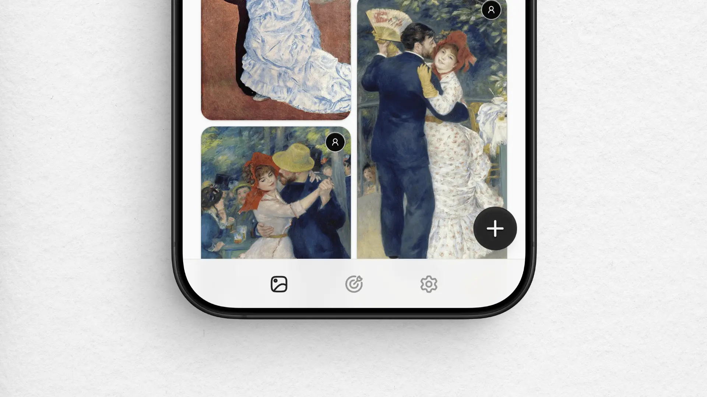
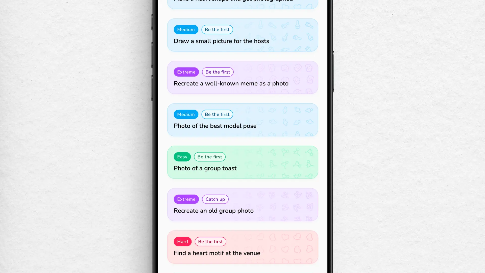

import BlogVideo from "@/components/blog-video.astro";

# A photo app for a wedding

Friends of mine recently got married. For their wedding, I built a small web app where guests could upload photos to a shared gallery and complete photo challenges together.

There are already apps for this, but I wanted more control over the look and feel. OpenAI's Codex helped with much of the coding, making the development quicker and easier. I ended up spending quite a bit of time on the details, especially the challenges, lightbox and image loading performance. I want to focus here on the visuals and product experience decisions, with only a brief look at the engineering behind them. The code is [open source on GitHub](https://github.com/michaelheckmann/event-photo-challenges).

## Making it easy to use

Most guests would probably only use this app for one event. There wouldn't be much time to get used to an unfamiliar interface, so I wanted the first visit to be straightforward.

Guests needed to scan a QR code to open the app in their browser without having to install anything. Since the app was made for the web, users did not have to install anything and it was compatible with any device by default.

I only asked for a name during onboarding so others could see who submitted each photo. I deliberately left that field open-ended: a first name, nickname or even an emoji would do. Two people could use the same first name. Requiring full names or adding strict validation felt excessive for an app like this.

After you enter your name, the app takes you to the main screen where a navigation bar at the bottom lets you move between the gallery, challenges and settings. There is also a large floating action button that opens the upload flow. I deliberately used familiar mobile patterns here. This follows [Jakob’s Law](https://www.nngroup.com/videos/jakobs-law-internet-ux/): people bring expectations from the products they already use. Guests would spend far more time in other apps than in this one, so it made sense to build on what they already knew.

## Making the challenges satisfying

The challenges are my favorite part. I wanted to give guests a few ideas for what to photograph, including things they might otherwise never think to do. Some prompts ask you to notice a detail; others ask you to find someone with the same zodiac sign or organize a group pose.

I used colors to distinguish the difficulty levels. If you only want to do one or two easy challenges, you can scan the list and pick those out. Labels such as “Be the first” or “Catch up” add a little encouragement to participate. Some challenges also have a limited number of places. Asking people to photograph the host (or the actual photographer!) can be fun, but having everyone repeat it could get annoying fairly quickly.

Completing a challenge should feel satisfying. I borrowed the emoji rain pattern from other apps and paired it with haptic feedback. It's a familiar effect, and I think it works well here: you upload your photo, the card changes state and there's a small celebration.

Each challenge has its own set of emojis. Photographing the youngest guest gets 👶 🍼 💛 📸, while taking a photo of the wedding cake gets 🍰 💍 ✨ 📸. It's a small adjustment, but I like that the reward relates to the photo you just took. It feels a little more personal than a standard shower of confetti.

After you complete a challenge, its card turns gray and shows the photo you submitted. You can tap it to open that image in the lightbox, where you can download or delete it. The photo makes it clear which challenges you've completed and gives you a way to revisit the result.

If you haven’t completed a challenge and all its places are taken, the card turns gray with no photo and the label “All spots taken.” It stays in the list because a place can become available again: deleting a challenge photo frees a spot, and the person who deleted it can complete the challenge again too.

<BlogVideo
  src="https://player.mediadelivery.net/play/800263/de8a8313-8606-4b6b-ae79-84e30cc91fb2"
  title="Completing a photo challenge"
/>

I wasn't sure whether the guests would be into this kind of thing. They ended up taking a lot of photos and were quite focused on completing the challenges. The challenge to carry the groom was particularly fun, and the photos turned out great. I think people will remember that moment, which probably wouldn't have happened without the app.

## Making the interface feel tactile

Buttons and cards respond to your touch with a subtle shrinking motion. Different interactions, including switching tabs, selecting photos and completing an upload, have different haptic signals. The [WebHaptics](https://github.com/lochie/web-haptics) library made this easy to add.

The header text also morphs when you switch sections, using [Torph](https://torph.lochie.me/). I wanted a little motion here without making the interface too busy. The morph makes the change of screen visible without adding much movement.

<BlogVideo
  src="https://player.mediadelivery.net/play/800263/94a4d736-8aa2-43f0-832c-b5383955db2b"
  title="Tab changes and touch interactions"
/>

## Browsing photos full-screen

I designed the photo viewer around touch gestures and mobile-native interaction patterns. When you open an image, it takes over the screen, and you swipe vertically to move through the collection. The next photo snaps into place as you scroll. It's closer to the vertical browsing pattern you know from Instagram than a conventional image lightbox.

Many lightboxes have a strip of small thumbnails along the bottom and controls for moving left or right. For this app, I wanted the main interaction to be the swipe itself. You can open a photo and keep moving through the others using a gesture you already know, with each image getting the full screen.

<BlogVideo
  src="https://player.mediadelivery.net/play/800263/196e8f4d-273a-4f60-8d77-3ea0879edf3e"
  title="Browsing photos full-screen"
/>

There are a couple of smaller details that help this work. The gallery behind the photo stops scrolling while the full-screen view is open. The browser's theme color changes too, so the browser chrome follows the photo view.

## Loading and downloading photos

Getting the gallery to load smoothly took more work than I expected. Images were slow to load, and the masonry grid had rendering issues that made the layout shift around. I spent some time tweaking the virtualization and making sure image dimensions were available before the grid positioned them, so browsing the gallery wouldn't keep rearranging the photos.

The originals are stored in Cloudflare R2, and I used Cloudflare image transformations to produce smaller versions for display. Responsive image sizes let the gallery use smaller thumbnails while the full-screen view gets a larger image. Together with caching, this avoids downloading an original photo every time a small preview is needed. I hadn't used Cloudflare's image transformations before, so figuring out the setup was part of the work too.

For bulk downloads, I set up a GitHub Action that builds a ZIP archive and stores it in R2. Guests download that prepared file, so they don't have to wait for the app to collect and package the photos when they request it. The download contains the collection from the most recent archive build.

I also made versions of the challenge photos with the prompt baked into the image. The text sits along the bottom in white, over a dark gradient that keeps it readable against the photo. That way, the challenge stays with the picture when someone saves or shares it outside the app. The ZIP includes both the originals and the captioned versions, so guests can choose which they want to keep.

I'm happy with how it turned out, especially the challenge cards and the full-screen browsing. Seeing the guests use it as much as they did was a nice bonus. If you'd like to look through the implementation, it's available [on GitHub](https://github.com/michaelheckmann/event-photo-challenges).
